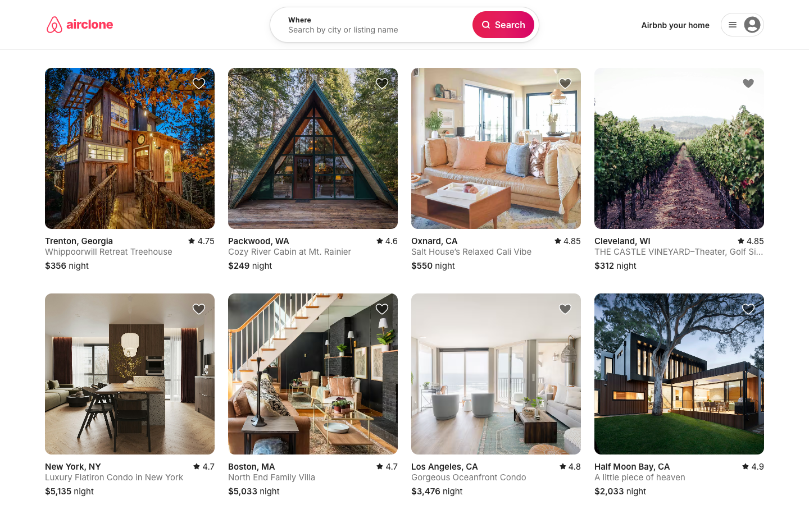
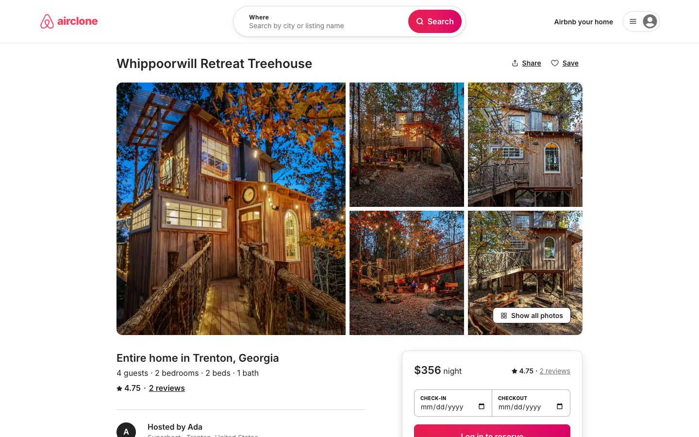
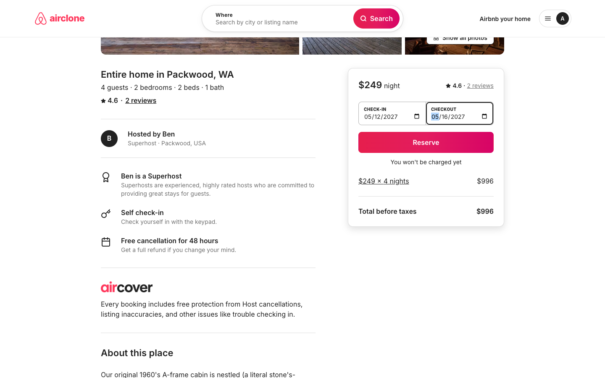
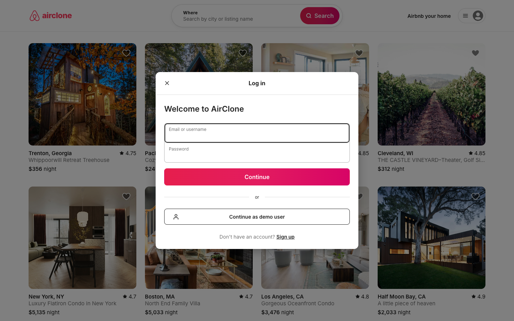

# 🏝️ AirClone

A full-stack Airbnb clone. Browse stays, book dates, leave reviews, save favorites to a wishlist, and list your own place, all in a UI modeled closely on Airbnb's.

**[Live demo →](https://sarah-booking-spots.onrender.com)**  ·  Log in with **Continue as demo user** to try everything without signing up.

> The demo is hosted on Render's free tier, so the first load after a period of inactivity can take ~30 seconds while the server wakes up.



## ✨ Features

- **Browse stays**: responsive listing grid (1–6 columns) with photos, location, rating and nightly price
- **Search**: find stays by city or listing name
- **Listing details**: photo mosaic with a full-screen gallery, host info, amenities, reviews and house rules
- **Bookings**: pick check-in/checkout dates and see the nightly breakdown and total before reserving; change dates or cancel from **Trips**
- **Reviews**: leave a 1–5 star review on places you've stayed; edit or delete your own
- **Wishlists**: tap the heart on any listing to save it; see all saved stays under **Wishlists**
- **Hosting**: create, edit and delete your own listings via **Airbnb your home**
- **Auth**: sign up, log in, log out, or continue as a demo user

## 📸 Screenshots

| Listing page | Reserving a stay |
| --- | --- |
|  |  |

| Log in |
| --- |
|  |

## 👩‍💻 Tech stack

| Layer | Tools |
| --- | --- |
| Frontend | React 18, Redux + Redux Thunk, React Router 5, React Icons, CSS |
| Backend | Node.js, Express, Sequelize ORM, express-validator |
| Auth & security | JWT cookies, bcrypt, CSRF protection (csurf), Helmet |
| Database | PostgreSQL (production), SQLite (development) |
| Hosting | Render |

## 🏁 Running locally

**Prerequisites:** Node.js 16+ and npm.

1. **Clone the repo**
   ```bash
   git clone https://github.com/lingxiGitHub/AirBnB.git
   cd AirBnB
   ```

2. **Install dependencies** for the backend and frontend
   ```bash
   npm install
   ```

3. **Create `backend/.env`**
   ```
   PORT=8000
   DB_FILE=db/dev.db
   JWT_SECRET=<any random string>
   JWT_EXPIRES_IN=604800
   ```

4. **Set up the database**
   ```bash
   cd backend
   npx dotenv sequelize-cli db:migrate
   npx dotenv sequelize-cli db:seed:all
   ```

5. **Start the servers** in two terminals
   ```bash
   # terminal 1
   cd backend && npm start      # API on http://localhost:8000

   # terminal 2
   cd frontend && npm start     # app on http://localhost:3000
   ```

To reset the database, delete `backend/db/dev.db` and repeat step 4.

> If port 8000 is already in use, set a different `PORT` in `backend/.env` and update the `proxy` field in `frontend/package.json` to match.

## 🔌 API overview

All routes are prefixed with `/api`.

| Resource | Routes |
| --- | --- |
| Session | `GET /session`, `POST /session`, `DELETE /session` |
| Users | `POST /users` |
| Spots | `GET /spots`, `GET /spots/current`, `GET /spots/:id`, `POST /spots`, `PUT /spots/:id`, `DELETE /spots/:id`, `POST /spots/:id/images` |
| Reviews | `GET /reviews/current`, `GET /spots/:id/reviews`, `POST /spots/:id/reviews`, `PUT /reviews/:id`, `DELETE /reviews/:id` |
| Bookings | `GET /bookings/current`, `GET /spots/:id/bookings`, `POST /spots/:id/bookings`, `PUT /bookings/:id`, `DELETE /bookings/:id` |
| Search | `GET /search/:keyword` |
| Wishlist | `GET /save/current`, `POST /save/:spotId`, `DELETE /save/:spotId` |

## 📝 Contact

Xi (Sarah) Ling · lingxi1023@gmail.com · [GitHub](https://github.com/lingxiGitHub)
